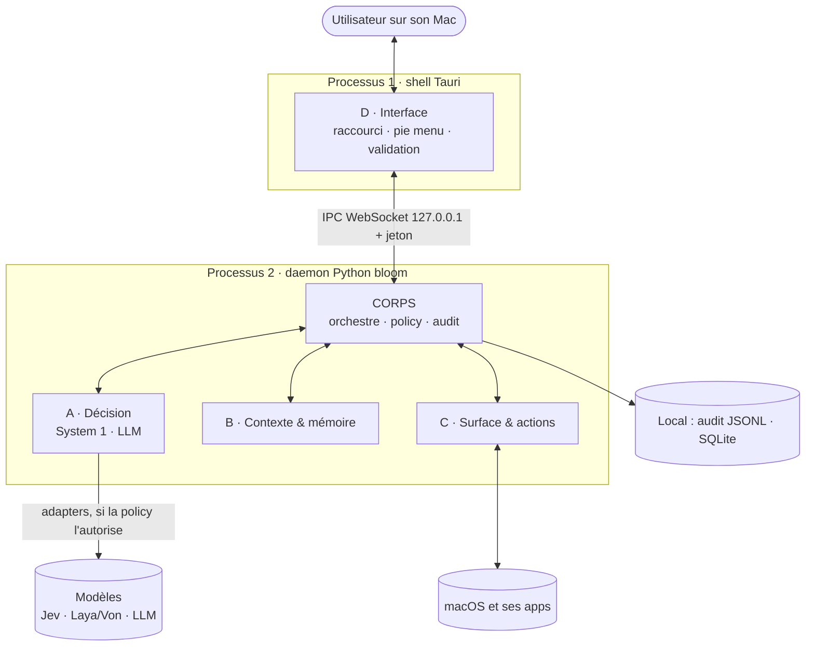
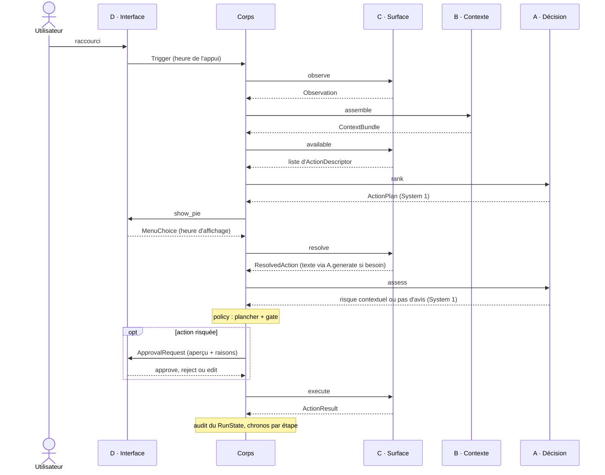
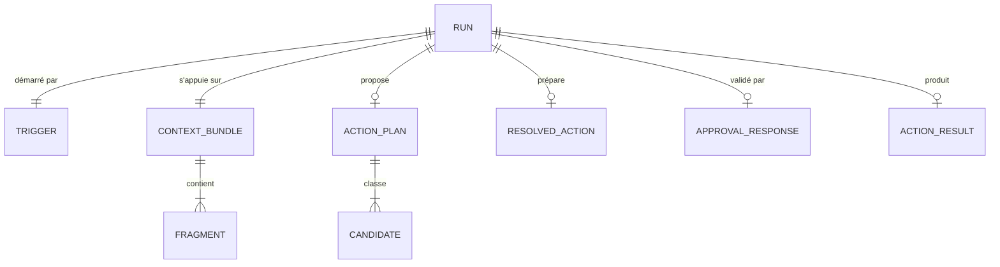

# Architecture de Bloom (V1)

> Livrable O2 « architecture diagram + data diagram » : première version attendue fin novembre, puis mise à jour à chaque changement structurant. Un schéma qui ne correspond plus au code est un bug, à corriger dans la PR qui l'a cassé.

## 1. Vue d'ensemble

- **Deux processus** sur la machine : le shell Tauri (bloc D) affiche et remonte, sans rien décider ; le daemon Python contient le corps et les blocs A, B, C.
- **Règle d'or** : les blocs ne se parlent jamais directement. Tout passe par le corps, et par des types définis dans `contracts.py`.
- **Frontière de déploiement** : tout tourne en local, sauf les appels aux modèles hébergés. Ils ne passent que par `decision/adapters/`, et seulement si la policy autorise ce backend pour la sensibilité du contexte.
- **IPC** : WebSocket sur 127.0.0.1, avec un jeton aléatoire passé au lancement et une vérification de l'en-tête Origin (n'importe quelle page web ouverte peut tenter de joindre un WebSocket local).

## 2. Le run, de bout en bout

Chaque étape correspond à quelques lignes de `src/bloom/core/pipeline.py`. Le corps chronomètre chaque étape (`RunState.timings_ms`) : c'est l'outillage de diagnostic de PERF.

## 3. Le corps et les blocs

| | Fait | Reçoit | Rend | Ne fait pas |
|---|---|---|---|---|
| **Corps** | enchaîne les étapes, applique la policy, journalise | `Trigger` | `RunState` | aucune logique métier |
| **A · Décision** | classe (System 1), évalue le risque (System 1), écrit (LLM, injecté dans C) | contexte + actions ; action préparée | `ActionPlan` ; `Criticality` ou rien ; texte | chercher le contexte, exécuter, trancher la sécurité finale |
| **B · Contexte** | collecte, étiquette, coupe au budget ; retient (v1.0) | `Observation` | `ContextBundle` | réseau, choix d'action |
| **C · Surface** | observe l'écran, fournit le catalogue, prépare, exécute | `Trigger` ; action choisie | `Observation` ; `ActionDescriptor` ; `ResolvedAction` ; `ActionResult` | juger le risque, demander la validation |
| **D · Interface** | raccourci, pie menu, fenêtre de validation | `ActionPlan` ; `ApprovalRequest` | `MenuChoice` ; `ApprovalResponse` | logique métier |

## 4. Les contrats

Source de vérité : `src/bloom/core/contracts.py`. Les types TypeScript du shell seront générés depuis ces modèles (JSON Schema), jamais écrits à la main.

| Contrat | Produit par | Consommé par | Contient |
|---|---|---|---|
| `Trigger` | D | corps | type de déclencheur, heure de l'appui |
| `Observation` | C | corps, puis B | application, fenêtre, sélection, URL |
| `ContextBundle` / `Fragment` | B | A, C | fragments étiquetés : source, sensibilité, confiance, coût en tokens |
| `ActionDescriptor` | C | A, D | id, libellé, plancher de criticité |
| `ActionPlan` / `Candidate` | A | D | top-k actions, probabilités, backend utilisé |
| `MenuChoice` | D | corps | action choisie ou annulation, heure d'affichage |
| `ResolvedAction` | C | corps, D | arguments remplis, aperçu exact |
| `ApprovalRequest` / `ApprovalResponse` | corps / D | D / corps | aperçu et raisons ; approve, reject ou edit |
| `ActionResult` | C | corps | succès, détail, jeton d'annulation |
| `RunState` | corps | audit, lab | tout le run, chronos par étape |

Les façades des blocs sont définies dans le même fichier : `DecisionPort` et `Generator` (modèles), `Ranker` (A), `ContextAssembler` (B), `Surface` (C), `Interface` (D), `Audit` (corps).

## 5. Règles de sécurité (`policy.py`)

1. **Criticité effective** = max(plancher déclaré par l'action, avis contextuel du modèle). Modèle muet ou indisponible : le plancher seul.
2. **Validation obligatoire** si l'action est `EXTERNAL` (toujours), si sa criticité atteint le seuil de l'utilisateur (`DESTRUCTIVE` par défaut), ou si le contexte contient du contenu tiers (`UNTRUSTED`) et que l'action modifie quelque chose (au moins `REVERSIBLE`). C'est la défense contre l'injection indirecte.
3. **Routage par sensibilité** : chaque backend déclare la donnée la plus sensible qu'il a le droit de voir ; un fragment `LOCAL_ONLY` exclut tout backend distant, par construction.
4. **On valide le contenu réel** : la génération a lieu avant la validation, l'humain voit le mail écrit, pas une intention.

Ces règles sont testées sur toutes les combinaisons (`tests/core/test_policy.py`), et le test d'intégration vérifie qu'une action refusée n'est jamais exécutée.

## 6. Données

| Donnée | Volume attendu (estimation V1) | Où | Conservation |
|---|---|---|---|
| Run (`RunState`) | 20 à 100 par jour et par utilisateur, 2 à 10 Ko chacun | `.bloom/audit.jsonl`, local | à fixer : contient des données personnelles (RGPD) |
| Fragments | 5 à 30 par run, budget de 4 000 tokens | mémoire vive | durée du run |
| Mémoire court terme | les dernières dizaines d'actions | SQLite local (v1.0) | fenêtre glissante |
| Jeu d'évaluation | 50 à 200 situations | `lab/datasets/` | anonymisé, commité |

Aucune donnée utilisateur ne quitte la machine, sauf vers un backend de décision que la policy autorise pour la sensibilité concernée.

## 7. Points de panne

| Si… | Effet | Comportement prévu | Statut |
|---|---|---|---|
| le backend de décision distant ne répond pas | pas de classement | repli sur le backend suivant autorisé (local, puis règles) ; `decided_by` le trace | ✅ ranker |
| aucun backend ne peut répondre | pas de classement | run échoué proprement et audité ; à terme, menu avec les seules actions fixes | 🟨 menu dégradé à faire |
| le daemon Python plante | le shell ne répond plus | le shell affiche « Bloom indisponible » et relance le daemon | ⬜ v0.2 |
| la permission Accessibilité est retirée | observation vide | menu dégradé + invitation à réactiver | ⬜ v0.2 |
| le LLM génératif est lent ou indisponible | action d'écriture impossible | erreur claire, rien n'est exécuté | ⬜ v0.2 |
| la validation reste sans réponse | run en attente | annulé à expiration (2 min) : jamais exécuté par défaut | ⬜ v0.4 |
| un contenu tiers contient une injection | le modèle propose une action dangereuse | plancher + gate `UNTRUSTED` : validation obligatoire | ✅ policy |
| la charge double (raccourcis en rafale) | runs concurrents | un seul run actif : un nouveau raccourci annule le précédent | ⬜ v0.1 |
| un bloc lève une exception | run interrompu | run `FAILED`, erreur et état partiel audités | ✅ pipeline |

## 8. Choix structurants

Chaque choix, avec l'alternative écartée et la raison, est dans [`adr/`](adr/) : nouveau dépôt (0001), port de décision agnostique (0002), corps et 4 blocs en étoile (0003), daemon Python et shell Tauri (0004), outillage qualité (0005), pas de moteur de workflow en V1 (0006).
