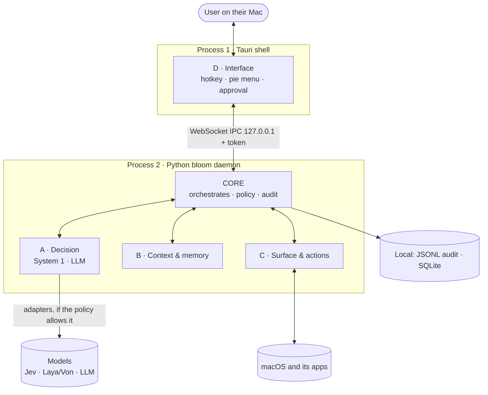
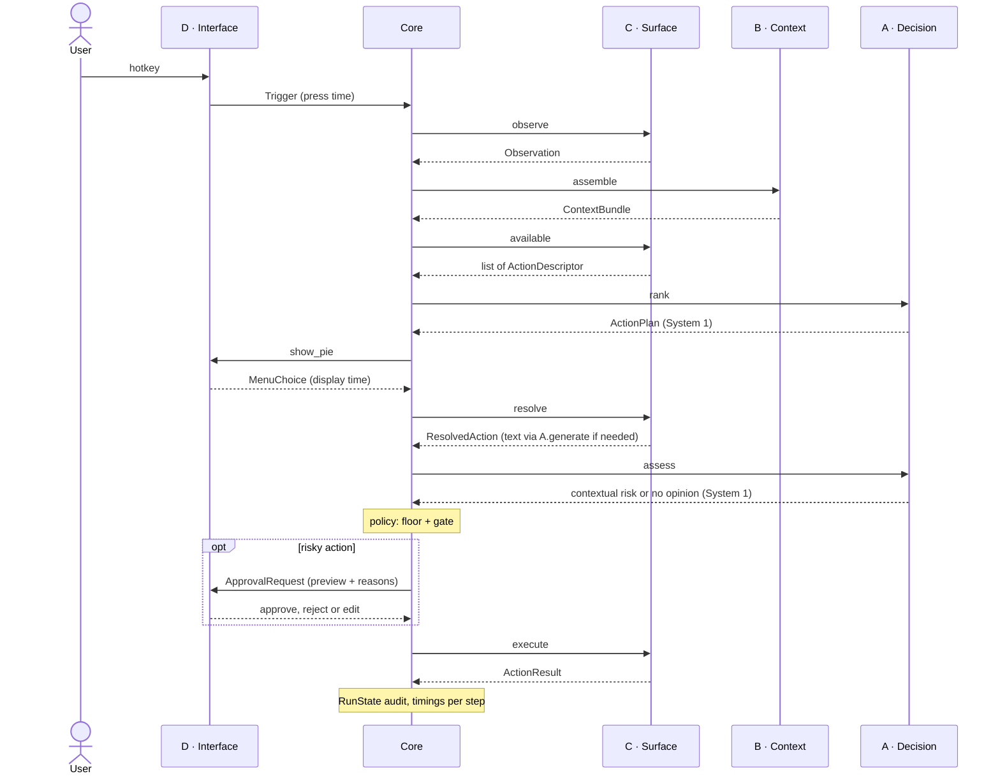
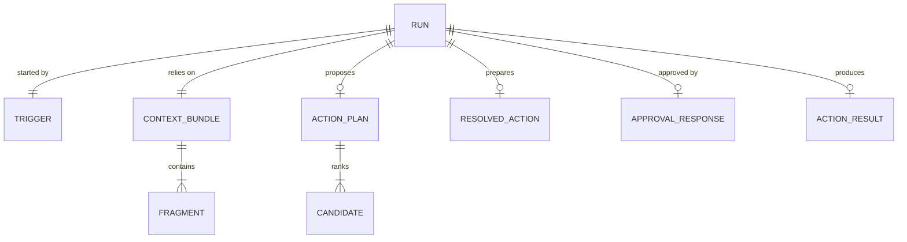

# Bloom architecture (V1)

> Deliverable O2 "architecture diagram + data diagram": first version due end of November, then updated at every structural change. A diagram that no longer matches the code is a bug, to be fixed in the PR that broke it.

## 1. Overview

- **Two processes** on the machine: the Tauri shell (block D) displays and reports back, without deciding anything; the Python daemon contains the core and blocks A, B, C.
- **Golden rule**: blocks never talk to each other directly. Everything goes through the core, and through types defined in `contracts.py`.
- **Deployment boundary**: everything runs locally, except calls to hosted models. They only go through `decision/adapters/`, and only if the policy allows that backend for the context's sensitivity.
- **IPC**: WebSocket on 127.0.0.1, with a random token passed at launch and a check of the Origin header (any open web page can try to reach a local WebSocket).

## 2. The run, end to end

Each step corresponds to a few lines of `src/bloom/core/pipeline.py`. The core times each step (`RunState.timings_ms`): this is the diagnostic tooling for PERF.

## 3. The core and the blocks

| | Does | Receives | Returns | Does not |
|---|---|---|---|---|
| **Core** | chains the steps, applies the policy, logs | `Trigger` | `RunState` | any business logic |
| **A · Decision** | ranks (System 1), assesses risk (System 1), writes (LLM, injected into C) | context + actions; prepared action | `ActionPlan`; `Criticality` or nothing; text | fetch the context, execute, make the final safety call |
| **B · Context** | collects, labels, trims to budget; remembers (v1.0) | `Observation` | `ContextBundle` | network, choice of action |
| **C · Surface** | observes the screen, provides the catalog, prepares, executes | `Trigger`; chosen action | `Observation`; `ActionDescriptor`; `ResolvedAction`; `ActionResult` | judge risk, request approval |
| **D · Interface** | hotkey, pie menu, approval window | `ActionPlan`; `ApprovalRequest` | `MenuChoice`; `ApprovalResponse` | business logic |

## 4. The contracts

Source of truth: `src/bloom/core/contracts.py`. The shell's TypeScript types will be generated from these models (JSON Schema), never written by hand.

| Contract | Produced by | Consumed by | Contains |
|---|---|---|---|
| `Trigger` | D | core | trigger type, press time |
| `Observation` | C | core, then B | application, window, selection, URL |
| `ContextBundle` / `Fragment` | B | A, C | labeled fragments: source, sensitivity, trust, token cost |
| `ActionDescriptor` | C | A, D | id, label, criticality floor |
| `ActionPlan` / `Candidate` | A | D | top-k actions, probabilities, backend used |
| `MenuChoice` | D | core | chosen action or cancellation, display time |
| `ResolvedAction` | C | core, D | filled-in arguments, exact preview |
| `ApprovalRequest` / `ApprovalResponse` | core / D | D / core | preview and reasons; approve, reject or edit |
| `ActionResult` | C | core | success, detail, undo token |
| `RunState` | core | audit, lab | the whole run, timings per step |

The block facades are defined in the same file: `DecisionPort` and `Generator` (models), `Ranker` (A), `ContextAssembler` (B), `Surface` (C), `Interface` (D), `Audit` (core).

## 5. Safety rules (`policy.py`)

1. **Effective criticality** = max(floor declared by the action, contextual opinion of the model). Model silent or unavailable: the floor alone.
2. **Approval required** if the action is `EXTERNAL` (always), if its criticality reaches the user's threshold (`DESTRUCTIVE` by default), or if the context contains third-party content (`UNTRUSTED`) and the action modifies something (at least `REVERSIBLE`). This is the defense against indirect injection.
3. **Routing by sensitivity**: each backend declares the most sensitive data it is allowed to see; a `LOCAL_ONLY` fragment excludes any remote backend, by construction.
4. **Approval covers the real content**: generation happens before approval; the human sees the written email, not an intention.

These rules are tested on every combination (`tests/core/test_policy.py`), and the integration test checks that a rejected action is never executed.

## 6. Data

| Data | Expected volume (V1 estimate) | Where | Retention |
|---|---|---|---|
| Run (`RunState`) | 20 to 100 per day per user, 2 to 10 KB each | `.bloom/audit.jsonl`, local | to be decided: contains personal data (GDPR) |
| Fragments | 5 to 30 per run, 4,000-token budget | RAM | duration of the run |
| Short-term memory | the last few dozen actions | local SQLite (v1.0) | sliding window |
| Evaluation set | 50 to 200 situations | `lab/datasets/` | anonymized, committed |

No user data leaves the machine, except to a decision backend that the policy allows for the sensitivity concerned.

## 7. Failure points

| If… | Effect | Planned behavior | Status |
|---|---|---|---|
| the remote decision backend does not respond | no ranking | fallback to the next allowed backend (local, then rules); `decided_by` records it | ✅ ranker |
| no backend can respond | no ranking | run fails cleanly and is audited; eventually, a menu with only the fixed actions | 🟨 degraded menu still to do |
| the Python daemon crashes | the shell stops responding | the shell displays "Bloom unavailable" and restarts the daemon | ⬜ v0.2 |
| the Accessibility permission is revoked | empty observation | degraded menu + prompt to re-enable it | ⬜ v0.2 |
| the generative LLM is slow or unavailable | writing action impossible | clear error, nothing is executed | ⬜ v0.2 |
| the approval gets no answer | run pending | cancelled on expiry (2 min): never executed by default | ⬜ v0.4 |
| third-party content contains an injection | the model proposes a dangerous action | floor + `UNTRUSTED` gate: approval required | ✅ policy |
| the load doubles (burst of hotkeys) | concurrent runs | a single active run: a new hotkey cancels the previous one | ⬜ v0.1 |
| a block raises an exception | run interrupted | run `FAILED`, error and partial state audited | ✅ pipeline |

## 8. Structural choices

Each choice, with the rejected alternative and the reason, is in [`adr/`](adr/): new repository (0001), model-agnostic decision port (0002), core and 4 blocks in a star (0003), Python daemon and Tauri shell (0004), quality tooling (0005), no workflow engine in V1 (0006).
